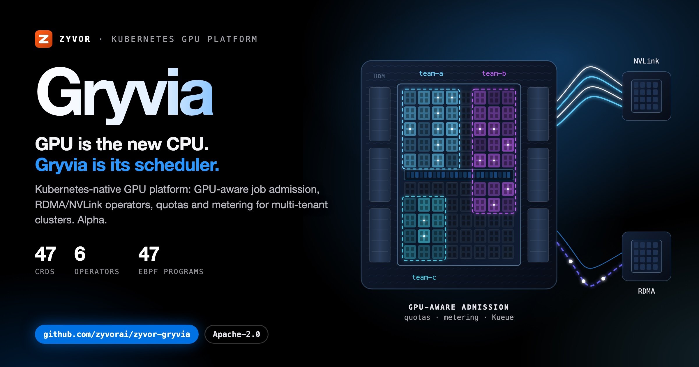
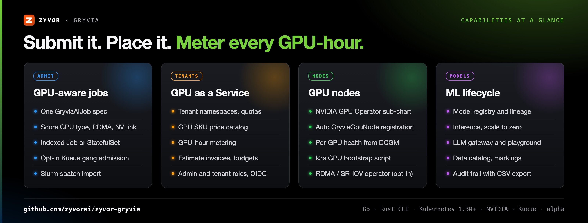
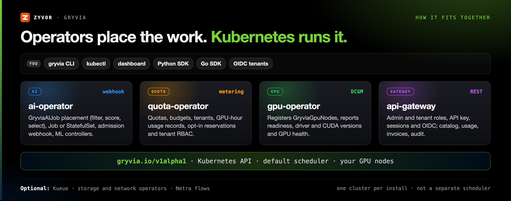
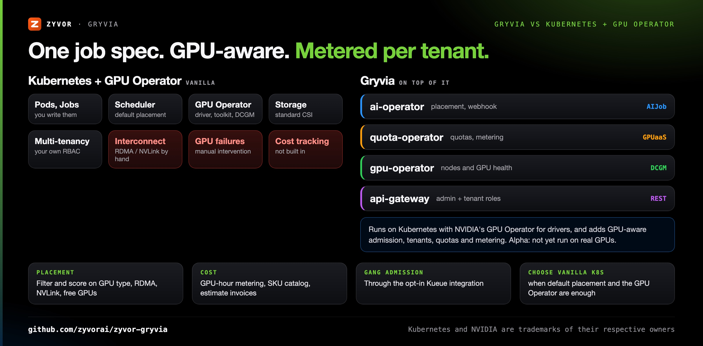

<div align="center">



# Gryvia

## Stop babysitting GPUs. Start shipping models.

### GPU is the new CPU. Gryvia is its scheduler.

**One Kubernetes-native platform to train, fine-tune and serve on shared GPU clusters.** Open source, Apache 2.0.

**Place** every job on the right GPU · **Share** them by the half, the MIG slice or the gang · **Bill** every team by the GPU-hour

[](https://zyvorai.github.io/zyvor-gryvia/)
[](LICENSE)
[](https://kubernetes.io/)
[](https://github.com/zyvorai/zyvor-gryvia)

[](#quickstart)
[](https://zyvor.dev/schedule?utm_source=github&utm_medium=gryvia&utm_campaign=readme_hero)
[](https://zyvor.dev/poc?utm_source=github&utm_medium=gryvia&utm_campaign=readme_hero)

[**Quickstart**](#quickstart) · [**Website**](https://zyvorai.github.io/zyvor-gryvia/) · [**Docs**](website/docs/intro.md) · [**Architecture**](#architecture) · [**What works today**](#what-works-today) · [**License**](#license)

</div>

---

## See it in 30 seconds

```bash
./scripts/kind-demo.sh                                   # whole platform on kind, demo data, dashboard, no GPUs needed
gryvia submit --image pytorch/pytorch --gpu 0.5 -- python train.py   # half a GPU, queued and placed for you
gryvia status                                            # what is running, where, and what it costs
```

Full walk-through: [Quickstart](#quickstart).

---

## Why Gryvia

<table width="100%">
<tr>
<td valign="top" width="33%">

### Every GPU, placed right
The ai-operator filters and scores nodes on GPU type, RDMA/SR-IOV, NVLink/NVSwitch, free GPUs and memory, and writes
its choice into the job status. One `GryviaAIJob` replaces hand-written Pods, Services and PVCs.<br>
[Scheduling guide](website/docs/guides/SCHEDULING.md)

</td>
<td valign="top" width="33%">

### Your scheduler, your choice
Hand placement to [KAI Scheduler](docs/kai-scheduler.md) (hierarchical queues, gangs, GPU fractions), use
[Kueue](docs/kueue-integration.md) for gang admission and fair sharing, or the built-in
[native queue scheduler](docs/native-scheduler.md). Every tenant gets its own queue.<br>
[KAI Scheduler](docs/kai-scheduler.md)

</td>
<td valign="top" width="33%">

### Half a GPU, or a hundred
`--gpu 0.5` shares one GPU between jobs, `--mig 1g.10gb` takes a MIG slice, and `--nodes 4` starts a multi-node gang
that runs all at once or not at all. Elastic jobs grow and shrink live.<br>
[Submit without YAML](#submit-without-yaml)

</td>
</tr>
<tr>
<td valign="top" width="33%">

### Notebooks and IDEs, one click away
JupyterLab and VS Code (code-server) open in the browser through the gateway with a signed, per-workspace session.
Idle workspaces pause themselves and keep their volume.<br>
[Workspaces](docs/workspaces.md)

</td>
<td valign="top" width="33%">

### Run it as a GPU cloud
Tenants with isolated namespaces, quotas and budgets, a GPU SKU price catalog, per-job GPU-hour metering and estimate
invoices, with provider and tenant roles in the gateway and dashboard.<br>
[GPU as a Service](website/docs/guides/GPU_AS_A_SERVICE.md)

</td>
<td valign="top" width="33%">

### From laptop to cluster in minutes
`scripts/kind-demo.sh` brings up the whole platform on kind with demo data, the dashboard and a notebook. One Helm
chart installs it on your cluster; one script turns a fresh GPU server into a node.<br>
[Quickstart](#quickstart)

</td>
</tr>
</table>



---

## Quickstart

Requirements: a Kubernetes 1.30+ cluster and Helm for an install; [kind](https://kind.sigs.k8s.io) (with a container
runtime) and `kubectl` for the demo. The CLI builds with `cargo build --release` in `cli/`.

### Try it in five minutes (no GPUs)

`scripts/kind-demo.sh` creates a local kind cluster, installs Gryvia, loads **fictional** demo data (GPU nodes, a
quota, a job), port-forwards the dashboard in the background and opens https://localhost:8443:

```bash
git clone https://github.com/zyvorai/zyvor-gryvia && cd zyvor-gryvia
./scripts/kind-demo.sh                          # published images
GRYVIA_LOCAL_IMAGES=1 ./scripts/kind-demo.sh    # build from this checkout; adds a Jupyter workspace you open from the dashboard
```

Sign in as `admin` / `Admin@321`. That is a well-known lab key: set your own (`auth.apiKey`) before sharing an
install; the sign-in page shows the `kubectl` command that reads the key in use. See
[Authentication and TLS](website/docs/guides/AUTH_AND_TLS.md).

### Install on your cluster

```bash
helm install gryvia oci://ghcr.io/zyvorai/charts/gryvia \
  --namespace gryvia-system --create-namespace \
  --set auth.apiKey='a-long-random-secret'
```

The chart installs the CRDs, the GPU, AI workload and quota operators, the API gateway and the dashboard; the storage
and network operators are off by default, and network intelligence is a separate chart. Then submit work with the CLI
or `kubectl`:

```bash
gryvia -n gryvia-system submit --file examples/training/simple-pytorch-training.yaml
gryvia -n gryvia-system list jobs
gryvia status                      # platform report; `gryvia status <job-name>` for one job
```

The example requests storage from a StorageClass named `vast-fast`; edit or remove that line unless you have one.

### Submit without YAML

The CLI writes Gryvia's custom resources, so everything it does is also plain YAML you can `kubectl apply` or keep in
Git. Add `--dry-run` to `gryvia submit` to print the YAML it would create.

| Task | Command |
|---|---|
| Train on one GPU | `gryvia submit --image pytorch/pytorch --gpu 1 -- python train.py` |
| Fractional GPU | `gryvia submit ... --gpu 0.5 [--gpu-memory 20480] [--isolation mps]` (needs `aiOperator.nativeQueueScheduler` or `aiOperator.kaiScheduler`) |
| MIG slice | `gryvia submit ... --gpu 1 --mig 1g.10gb` |
| Multi-node | `gryvia submit ... --gpu 8 --nodes 4` |
| Team and queue | `-n team-a --queue team-a` |
| Follow a job | `gryvia list jobs`, `gryvia status x`, `gryvia logs x -f`, `gryvia cancel x` |
| Notebook | `gryvia workspace new nb --type jupyter --gpus 1`, then `gryvia workspace open nb` or the dashboard's Workspaces page (needs `workspaceProxy`) |

---

## Pick your scheduler

Gryvia keeps the job lifecycle, tenants, metering and billing; the queueing engine is a Helm value.

| Backend | Turn it on | What you get |
|---|---|---|
| Built-in placement | default | GPU-type-, interconnect- and capacity-aware node selection, recorded in the job status |
| [KAI Scheduler](docs/kai-scheduler.md) | `aiOperator.kaiScheduler=true` (+ `quotaOperator.kaiIntegration=true`) | KAI places every pod: hierarchical queues, gangs, GPU fractions, a KAI queue per tenant, and KAI's reason in the job status while a job waits |
| [Kueue](docs/kueue-integration.md) | `kueue.enabled`, `aiOperator.kueueIntegration`, `quotaOperator.kueueIntegration` | Gang admission, quota borrowing, fair sharing and priority preemption, a ClusterQueue per tenant, and `status.queueExplanation` |
| [Native queue scheduler](docs/native-scheduler.md) | `aiOperator.nativeQueueScheduler=true` | Queue guarantees and ceilings with borrowing, gang admission, priority preemption and fractional-GPU accounting from one ConfigMap |

---

## How it fits together



### Architecture

```
 kubectl · gryvia CLI ─────────────────────────────┐
 Dashboard ──▶ API gateway (admin | tenant roles) ─┤──▶  Kubernetes API  (gryvia.io/v1alpha1 CRDs)
 Python SDK ──▶ API gateway      Go SDK ───────────┘            │
                                                                ▼
   Operators (helm/gryvia):  gpu · ai (+ admission webhook) · quota · [storage] · [network]
   Operator (helm/network-intelligence):  network-intelligence
   Scheduling backends (optional):  KAI Scheduler · Kueue · native queue gate
                                                                │
   GPU nodes:  NVIDIA GPU Operator (optional) ─▶ node labels ─▶ GryviaGpuNode (auto-registered)
   Observability:  DCGM exporter · optional eBPF collector DaemonSet · optional Netra flows
```

One cluster is managed per install; opt-in federation dispatches and fails over work across clusters through Kueue
MultiKueue ([federation failover](docs/federation-failover.md)).

<details>
<summary><b>Core components: six operators, 49 CRDs (43 with a runtime controller)</b></summary>

**Reconciled by a runtime controller (43; some opt-in).**
GPU operator: `GryviaHealthCheck` (opt-in health/remediation flags), `GryviaGpuNode` (also auto-created from GPU feature-discovery labels), `GryviaGpuMemoryOptimizer`, `GryviaGPUSharingPolicy` (opt-in `--enable-gpu-sharing`, chart `gpuOperator.gpuSharing`: writes the node labels for time-slicing and MIG) ·
AI operator: `GryviaAIJob`, `GryviaCheckpointGuard`, `GryviaLiveExperiment`, `GryviaModelLineage`,
`GryviaTrainingProfiler`, `GryviaTrainingTimeMachine`, and the ML kinds `GryviaWorkspace`, `GryviaInferenceService`,
`GryviaModelRegistry`, `GryviaWorkflow`, `GryviaAutoTuner`, `GryviaPriority`, `GryviaTemplate` (on by default, `--enable-ml-controllers`), plus
`GryviaModelWatch` (only with `--enable-model-watch`, see [Model factory](docs/model-factory.md)), `GryviaVectorIndex` (only with `--enable-rag`, see [RAG](docs/rag.md)), `GryviaAgent` (only with `--enable-agents`, see [Agents](docs/agents.md)), `GryviaJobHook` (only with `--enable-job-hooks`, see [Job hooks](docs/job-hooks.md)), `GryviaFederation` (only with an administrator server allowlist), `GryviaFabricSignal` (only with `--merge-fabric-signals`) · Quota operator: `GryviaQuota`, `GryviaTenant`,
`GryviaUsageRecord`, `GryviaCostPredictor`, `GryviaBudget`, `GryviaChargeback`, `GryviaReservation` (only with `--enable-reservations`) · Storage operator: `GryviaStorage`, `GryviaDataset` (only with `--enable-datasets`, see [Datasets](docs/datasets.md)) · Network operator: `GryviaNetwork` ·
Network-intelligence operator: `GryviaFlowPolicy`, `GryviaTrafficInsight`, `GryviaAutoPolicy`, `GryviaTraceSession`,
`GryviaServiceGraph`, `GryviaNetworkAnomaly`, `GryviaSecurityPolicy`, `GryviaNetworkCost`, `GryviaTrainingInsight`,
`GryviaInferenceInsight`.

**Data kinds without a controller (6).** `GryviaGpuSku`, `GryviaNetworkRate`, `GryviaNetworkUsageRecord` and `GryviaNodeFabric` are catalog/telemetry data read by other controllers. `GryviaLedgerEntry` (appended by the quota-operator for each sealed usage record) and `GryviaInvoice` (written by the API gateway) are the opt-in immutable billing records, see [Billing ledger](docs/billing-ledger.md). The legacy kinds `GryviaAutoScaler`, `GryviaRetryPolicy`, `GryviaSLA`, `GryviaAudit`, `GryviaQuotaPolicy`, `GryviaMetric`, `GryviaBenchmark` and `GryviaDRTest`, which never had a runtime, were removed; see the [CHANGELOG](CHANGELOG.md) for the upgrade steps.

**Six operators:** GPU (registers `GryviaGpuNode`s and reports readiness, driver/CUDA versions and DCGM health; NVIDIA's
GPU Operator installs the drivers) · AI workload (`GryviaAIJob` placement and Job/StatefulSet workloads, the admission
webhook, the ML controllers, the KAI, Kueue and native scheduling integrations, and the profiler, checkpoint-guard,
live-experiment, lineage and time-machine CRDs) · Quota (quotas and per-namespace budgets, tenants, usage metering,
node reservations, tenant RBAC and per-tenant Kueue or KAI queues) · Storage and Network (optional; parallel-filesystem
CSI backends, and RDMA/SR-IOV device plugins with Multus attachments) · Network Intelligence (Cilium policy actions and
insights; its own chart).

**GPU-aware node selection:** the AI operator lists nodes and their running GPU pods, filters out nodes that are not
ready, have the wrong `gryvia.io/gpu` type, lack the requested RDMA/SR-IOV label or the free GPUs, then scores the rest
(GPU type match +50, RDMA +30, NVSwitch +40 or NVLink +30 for multi-GPU jobs, +5 per free GPU, +1 per 10 GB of GPU
memory, plus CPU/memory) and takes the top `distributed.nodes`. It records that choice in `status.nodesAllocated`; the
pods are constrained by node selector and placed by the Kubernetes scheduler (or by KAI when it is on). Detail:
[Scheduling guide](website/docs/guides/SCHEDULING.md).

</details>

### Gryvia vs plain Kubernetes + GPU Operator, in four rows

| You want | Plain Kubernetes | Gryvia |
|---|---|---|
| To run a training job | Write Pods, Services and PVCs | One `GryviaAIJob`, or `gryvia submit` |
| Half a GPU or a gang | Manual time-slicing, no gangs | `--gpu 0.5`, `--nodes 4` |
| Fair queues per team | Build it yourself | KAI, Kueue or the native queue, one per tenant |
| To know who used what | Not built in | GPU-hour metering, budgets, estimate invoices |

<details>
<summary><b>Gryvia vs Kubernetes + GPU Operator: the full table</b></summary>



Gryvia runs on Kubernetes and uses NVIDIA's GPU Operator for drivers; this is what it adds on top.

| Capability | Vanilla K8s + GPU Operator | Gryvia |
|---|---|---|
| Job spec | Pods, Jobs and StatefulSets you write | One `GryviaAIJob` (type, gpus, gpuType, distributed); the operator creates the Indexed Job (or a StatefulSet for inference), the headless Service and the PVC |
| Job placement | Default scheduler (first-fit) | Nodes filtered and scored on GPU type, RDMA/SR-IOV, NVLink, free GPUs and memory; gangs and queues through KAI Scheduler, Kueue or the native queue gate |
| GPU sharing | Whole GPUs, or manual time-slicing | `--gpu 0.5` through KAI GPU fractions or the native scheduler (MIG, MPS, DRA) |
| RDMA/NVLink setup | Manual | Network operator creates device plugins and Multus attachments |
| Storage for training | Standard CSI | Storage operator for VAST, Weka, DDN, Lustre and CephFS backends |
| GPU failure handling | Manual intervention | Per-GPU health on `GryviaGpuNode` (DCGM), quarantine and an escalating reset, driver-reload, reboot ladder |
| Cost tracking | Not built in | GPU-hour metering, SKU catalog, estimate invoices, per-team quotas and budgets, chargeback |
| Multi-tenancy | Namespaces and your own RBAC | `GryviaTenant` namespaces with quota, NetworkPolicy, per-tenant queues and RBAC |

</details>

<details>
<summary><b>What's new</b></summary>

From the Unreleased section of the [changelog](CHANGELOG.md); each entry there says how it was tested.

| Feature | What it does |
|---|---|
| **KAI Scheduler backend** | `aiOperator.kaiScheduler`: KAI places every `GryviaAIJob` pod, with gangs, GPU fractions, a KAI queue per tenant and KAI's reason in the job status ([guide](docs/kai-scheduler.md)) |
| **Workspaces in the browser** | JupyterLab and VS Code through the gateway with signed launch links, per-workspace cookies and idle pause ([guide](docs/workspaces.md)) |
| **Submit without YAML** | `gryvia submit --image ... --gpu 0.5 -- cmd`, plus `gryvia workspace` commands |
| **Native queue scheduler** | `--native-queue-scheduler`: queue guarantees and ceilings with borrowing, atomic gang admission, priority preemption and fractional-GPU accounting, without Kueue ([guide](docs/native-scheduler.md)) |
| **Workload intelligence** | Preflight, training evidence, useful-work cost, inference SLO recommendations, model benchmarking, capacity simulation and sovereign placement, with reviewed, reversible operations ([guide](docs/workload-intelligence.md)) |
| **Operator copilot** | Plain-language questions about jobs, models, datasets and lineage over read-only tools, with your own LLM key |
| **Data catalog, lineage and audit** | Searchable `GryviaDataset`s with markings, dataset → job → model → service lineage, durable audit with CSV export |
| **Scale to zero** | `GryviaInferenceService.spec.scaleToZero`, woken by the LLM gateway on the next request |
| **Slurm on Kubernetes** | Slinky slurm-operator sub-chart, per-tenant partitions, `gryvia submit --sbatch` |

</details>

<details>
<summary><b>GPU servers: drivers, CUDA and the device plugin</b></summary>

On a fresh Ubuntu 22.04/24.04 server with an NVIDIA GPU, one command installs k3s, Gryvia and NVIDIA's GPU Operator
(driver, container toolkit, device plugin, DCGM):

```bash
sudo ./scripts/install-k3s-gpu.sh server
```

On an existing cluster, add `--set nvidia.enabled=true` to the Helm install. Gryvia then registers every GPU node
automatically. It does not install a CNI, Multus or InfiniBand drivers. The checklist for a real machine is in
[docs/gpu-validation.md](docs/gpu-validation.md). Details: [GPU nodes](website/docs/guides/GPU_NODES.md) ·
[Deployment guide](website/docs/guides/DEPLOYMENT_GUIDE.md) ·
[Complete deployment guide](website/docs/guides/COMPLETE_DEPLOYMENT_GUIDE.md).

</details>

<details>
<summary><b>GPU as a Service</b></summary>

Run the cluster as a multi-tenant GPU cloud: the provider (API key or an OIDC admin group) creates `GryviaTenant`s
(namespace `tenant-<name>` with quota and optional NetworkPolicy) and publishes `GryviaGpuSku` prices; tenants sign in
with OIDC and see only their own jobs, usage and catalog; the quota operator meters GPU hours into `GryviaUsageRecord`s.

```bash
gryvia catalog                         # SKUs and hourly rates
gryvia tenant list
gryvia usage --group-by tenant
gryvia invoice --month 2026-09         # estimate: JSON or CSV, no payments
```

Also in the dashboard (Catalog, Usage, Tenants, Invoices) and under `/api/skus`, `/api/tenants`, `/api/usage`,
`/api/invoices`. See [GPU as a Service](website/docs/guides/GPU_AS_A_SERVICE.md) and
[GPU cloud platform](docs/gpu-cloud-platform.md).

</details>

<details>
<summary><b>Admission, recovery and inference serving</b></summary>

Optional strict tenant Kueue admission, distributed worker spreading and cooperative checkpoint hooks are described in
[docs/admission-recovery.md](docs/admission-recovery.md). Checkpoint hooks require a compatible trainer and persistent
storage.

Explicit GPU/RPS autoscaling targets use custom per-pod HPA metrics, and opt-in Gateway API routing adds weighted
canary traffic and accepted-route promotion gating. Opt-in Prometheus SLO analysis blocks promotion on missing
telemetry and rolls back measured error-rate/p95 breaches. See [docs/inference-serving.md](docs/inference-serving.md).

</details>

---

<a id="what-works-today"></a>

## What works today

Gryvia is **alpha**: APIs (`gryvia.io/v1alpha1` CRDs) may change between releases and there is no upgrade guarantee
yet. Everything below is the repository's own statement of what has been tested and where; the
[changelog](CHANGELOG.md) and each guide say how. **Nothing has run on GPU hardware yet**: GPU paths are tested with
simulated GPUs (fake-gpu-operator), fake clients and kind clusters, and the GPU validation checklist in
[docs/gpu-validation.md](docs/gpu-validation.md) is still to be run on a real machine.

| State | What |
|---|---|
| **Implemented and tested in CI** (unit tests, chart rendering, a kind install with demo data read back through the API and CLI) | The Helm chart; GPU, AI workload and quota operators; `GryviaAIJob` placement, run-to-completion Job and StatefulSet creation and the admission webhook; per-namespace quotas and budgets; tenants, SKU catalog, usage metering and estimate invoices; the API gateway with API-key, session and OIDC roles; the dashboard; the CLI |
| **Run end to end on kind (simulated GPUs or CPU pods)** | KAI Scheduler backend (`scripts/e2e-kai.sh`: placement, half-GPU sharing, a 3-pod gang, tenant queues, KAI's reason in job status; KAI v0.18.5 and fake-gpu-operator); JupyterLab and code-server workspaces through the proxy (`scripts/e2e-workspaces.py`); Kueue gang admission and fair sharing (CPU pods); elastic resize and node-loss recovery of torchrun jobs (CPU); MultiKueue federation failover across three kind clusters |
| **Implemented, unit tests or a CPU-only kind e2e; unverified on real clusters, GPUs and services** | The ML controllers for workspaces, inference services, the model registry, workflows and the auto tuner, and the opt-in model factory (no real fine-tune has run); the native queue scheduler (unit tests and a CPU-only k3s cluster); opt-in admission gate for quotas and hard budgets, node reservations, per-tenant RBAC and the signed invoice webhook; Prometheus metrics, dashboards, alerts and runbooks (never rendered against a live Prometheus or Grafana); the network-intelligence operator's collector and Netra sources (fake collector only); NVIDIA GPU Operator sub-chart, `install-k3s-gpu.sh` and node auto-registration (GPU-less k3s in CI only); storage and network operators (off by default); OIDC (fake identity provider only); GPU health remediation (fake runners); anything that needs GPUs, RDMA or a parallel filesystem |
| **Experimental** | The eBPF collector, the 47 eBPF programs (verifier-load on x86_64 and arm64, attached on one Linux 7.0 x86_64 host only), fabric signals and the Flight Recorder; the network-intelligence operator |
| **Removed legacy APIs** | SLA, audit, auto-scaler, retry policy, DR tests, benchmarks, metrics and quota policies (the CHANGELOG has the upgrade steps) |
| **Not implemented** | Payments or tax invoices, a multi-cluster scheduler of its own (dispatch and failover go through Kueue MultiKueue), a mutating quota-pacing eBPF program |

**Performance.** The only measured numbers are the eBPF collector's overhead on one shared x86 host
([docs/ebpf-overhead.md](docs/ebpf-overhead.md)). The following are **design targets**, to be validated with
`benchmarks/suite.yaml` on real hardware before they are quoted as results:

<a id="performance-metrics"></a>

| Metric | Target |
|---|---|
| Job scheduling latency | < 500 ms (8-GPU job) |
| Fault recovery time | < 60 s (node failure) |
| Concurrent queued jobs | 10,000+ |

**Security.** Two roles in the API gateway: the API key and dashboard sessions are the provider **admin**; OIDC users
(JWT validation, PKCE in the dashboard) are **tenant** users limited to the namespaces of their `GryviaTenant`.
State-changing requests are audited. HTTPS for the dashboard and gateway, non-root read-only containers, per-tenant
namespaces with ResourceQuotas, LimitRanges and optional NetworkPolicies, and cosign-signed release images and charts
with SBOM and provenance. The eBPF collector is privileged, `hostNetwork` and off by default. Read the
[threat model and known limits](SECURITY.md) before exposing an install beyond a lab, and report vulnerabilities
privately as described there.

The [CRD reference](website/docs/reference/crds.md) lists every kind with the operator that reconciles it (or `none`);
[platform completion](docs/platform-completion.md) lists the remaining integration and hardware limits.

---

## Documentation

| Topic | Doc |
|---|---|
| Project website (overview, how it works, install) | [zyvorai.github.io/zyvor-gryvia](https://zyvorai.github.io/zyvor-gryvia/) |
| Full documentation index | [website/docs/intro.md](website/docs/intro.md) |
| Quick start | [website/docs/getting-started/quickstart.md](website/docs/getting-started/quickstart.md) |
| Bare-metal / complete deployment | [DEPLOYMENT_GUIDE.md](website/docs/guides/DEPLOYMENT_GUIDE.md) · [COMPLETE_DEPLOYMENT_GUIDE.md](website/docs/guides/COMPLETE_DEPLOYMENT_GUIDE.md) |
| Authentication and TLS | [guides/AUTH_AND_TLS.md](website/docs/guides/AUTH_AND_TLS.md) |
| Cluster setup (admin) | [admin-guide/cluster-setup.md](website/docs/admin-guide/cluster-setup.md) |
| Job management (user) | [user-guide/jobs.md](website/docs/user-guide/jobs.md) |
| Scheduling internals | [guides/SCHEDULING.md](website/docs/guides/SCHEDULING.md) |
| KAI Scheduler, Kueue, native queue scheduler | [docs/kai-scheduler.md](docs/kai-scheduler.md) · [docs/kueue-integration.md](docs/kueue-integration.md) · [docs/native-scheduler.md](docs/native-scheduler.md) |
| Workspaces in the browser | [docs/workspaces.md](docs/workspaces.md) |
| Storage & network operators | [guides/STORAGE_NETWORK_OPERATORS.md](website/docs/guides/STORAGE_NETWORK_OPERATORS.md) |
| Network Intelligence (NetPredator) | [guides/NETWORK_INTELLIGENCE.md](website/docs/guides/NETWORK_INTELLIGENCE.md) |
| CLI guide | [guides/CLI_GUIDE.md](website/docs/guides/CLI_GUIDE.md) |
| API reference | [developer-guide/api-reference.md](website/docs/developer-guide/api-reference.md) |
| ML workflows, integrations, playbooks | [guides/ML_WORKFLOWS.md](website/docs/guides/ML_WORKFLOWS.md) · [guides/INTEGRATIONS.md](website/docs/guides/INTEGRATIONS.md) · [guides/OPERATIONAL_PLAYBOOKS.md](website/docs/guides/OPERATIONAL_PLAYBOOKS.md) |
| GPU as a Service (tenants, catalog, usage, invoices) | [guides/GPU_AS_A_SERVICE.md](website/docs/guides/GPU_AS_A_SERVICE.md) |
| Gryvia as a GPU cloud's platform | [docs/gpu-cloud-platform.md](docs/gpu-cloud-platform.md) |
| GPU nodes (NVIDIA GPU Operator, k3s bootstrap) | [guides/GPU_NODES.md](website/docs/guides/GPU_NODES.md) · [docs/gpu-validation.md](docs/gpu-validation.md) |
| NVIDIA one-click (RDMA, GDS, MIG, Network and NIM operators) | [guides/NVIDIA_ONE_CLICK.md](website/docs/guides/NVIDIA_ONE_CLICK.md) |
| Admission and recovery | [docs/admission-recovery.md](docs/admission-recovery.md) |
| Job submission preflight | [docs/job-submission-preflight.md](docs/job-submission-preflight.md) |
| Inference serving | [docs/inference-serving.md](docs/inference-serving.md) |
| Operations (upgrade, uninstall, backup) | [guides/OPERATIONS.md](website/docs/guides/OPERATIONS.md) |
| CRD reference (all kinds and their controllers) | [reference/crds.md](website/docs/reference/crds.md) |
| eBPF programs, collector, Flight Recorder | [ebpf/README.md](ebpf/README.md) · [collector/README.md](collector/README.md) · [docs/flight-recorder.md](docs/flight-recorder.md) |
| Helm charts | [helm/gryvia](helm/gryvia/README.md) · [helm/network-intelligence](helm/network-intelligence/README.md) |
| Advanced features, FAQ, roadmap | [guides/ADVANCED_FEATURES.md](website/docs/guides/ADVANCED_FEATURES.md) · [guides/FAQ.md](website/docs/guides/FAQ.md) · [guides/ROADMAP.md](website/docs/guides/ROADMAP.md) |
| Examples & tutorials | [examples/README.md](examples/README.md) |

---

## Part of the Zyvor stack

| Product | Role next to Gryvia |
|---|---|
| **Gryvia** | Kubernetes GPU platform: GPU-aware admission, tenants, quotas, metering |
| **[Netra](https://github.com/zyvorai/zyvor-netra)** | Real network flows for Gryvia's gateway and network-intelligence operator (`apiGateway.netra.url`) |
| **[Zyntra](https://github.com/zyvorai/zyvor-zyntra)** | Sovereign AI OS loop: an agent proposes in Zyntra, a person approves, and Zyntra writes the `GryviaPriority` ([docs/sovereign-aios.md](docs/sovereign-aios.md)) |
| **[Duvora](https://github.com/zyvorai/zyvor-duvora)** | DPU fleet control plane; pairs with Gryvia on accelerated clusters |
| **[Gryvia for Apple Silicon](https://github.com/zyvorai/zyvor-gryvia-apple)** | Native Swift Mac worker, SwiftUI desktop app and fleet console; runs independently of the Kubernetes `GryviaAIJob` path ([validation notes](https://github.com/zyvorai/zyvor-gryvia-apple/blob/main/TEST_RESULTS.md)) |

→ [zyvor.dev](https://zyvor.dev)

## Support

Free under Apache-2.0. If it helps you, you can donate any amount you like: <https://rzp.io/rzp/utwdYh3>. A donation is voluntary and supports development and maintenance. It is not a purchase: it buys no support, SLA, features, priority or license, and it is not tax-deductible (Zyvor AI Labs Private Limited is a company, not a charity). Zyvor Enterprise (supported releases, SLAs, a named contact and enterprise features) is separate: [sales@zyvor.dev](mailto:sales@zyvor.dev).

## Contributing

We welcome contributions: see [CONTRIBUTING.md](CONTRIBUTING.md).

## License

Gryvia is **free and open source** under the [Apache License 2.0](LICENSE). That does not change.

**Zyvor Enterprise** adds what production teams ask for: supported releases, deployment and upgrade guidance, priority
incident triage, a named technical contact and 24x7 critical intake. Plans and terms:
[docs/SUBSCRIPTION-MODEL.md](docs/SUBSCRIPTION-MODEL.md) ·
[Pricing](https://zyvor.dev/pricing?utm_source=github&utm_medium=gryvia&utm_campaign=readme_license) ·
[sales@zyvor.dev](mailto:sales@zyvor.dev).

---

<div align="center">

### Every GPU busy. Every team billed. Five minutes to try.

[](#quickstart)
[](https://zyvor.dev/schedule?utm_source=github&utm_medium=gryvia&utm_campaign=readme_footer)
[](https://zyvor.dev/poc?utm_source=github&utm_medium=gryvia&utm_campaign=readme_footer)
[](https://zyvor.dev/pricing?utm_source=github&utm_medium=gryvia&utm_campaign=readme_footer)
[](mailto:sales@zyvor.dev?subject=Gryvia)
[](https://github.com/zyvorai/zyvor-gryvia)

</div>
